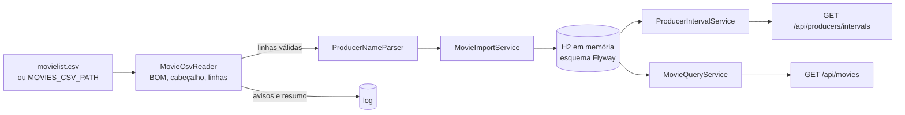

# Golden Raspberry Awards API

## 1. Visão geral

API REST que lê o CSV de indicados e vencedores da categoria Pior Filme do Golden Raspberry Awards ao
subir. Ela informa os produtores com o **menor** e o **maior** intervalo entre duas vitórias
consecutivas e lista os filmes com paginação e filtros.

---

## 2. Avalie em 2 minutos

**Pré-requisito:** só o **JDK 25** no `PATH`. Não é preciso Maven, Docker nem banco de dados: o
wrapper baixa o Maven, e o banco é um H2 em memória.

| | Linux, macOS ou Git Bash | Windows (PowerShell ou cmd) |
| --- | --- | --- |
| Subir a aplicação | `./mvnw spring-boot:run` | `.\mvnw.cmd spring-boot:run` |
| Rodar os testes | `./mvnw verify` | `.\mvnw.cmd verify` |

A aplicação responde em `http://localhost:8080`. A carga do CSV termina antes de o servidor aceitar
conexões, e o log mostra o resumo:

```text
Carga do arquivo classpath:movielist.csv concluída: 206 linhas lidas, 206 aceitas, 0 rejeitadas
```

**Intervalos entre prêmios** (o requisito do enunciado):

```bash
curl -s http://localhost:8080/api/producers/intervals
```

```json
{"min":[{"producer":"Joel Silver","interval":1,"previousWin":1990,"followingWin":1991}],"max":[{"producer":"Matthew Vaughn","interval":13,"previousWin":2002,"followingWin":2015}]}
```

**Listagem de filmes** (vencedores de 1990):

```bash
curl -s "http://localhost:8080/api/movies?year=1990&winner=true"
```

```json
{"content":[{"year":1990,"title":"Ghosts Can't Do It","studios":"Triumph Releasing","producers":"Bo Derek","winner":true},{"year":1990,"title":"The Adventures of Ford Fairlane","studios":"20th Century Fox","producers":"Steven Perry and Joel Silver","winner":true}],"page":0,"size":20,"totalElements":2,"totalPages":1}
```

> No Windows PowerShell 5.1, `curl` é um apelido de `Invoke-WebRequest`. Use `curl.exe`, com os mesmos
> argumentos.

Documentação interativa: <http://localhost:8080/swagger-ui.html>.

---

## 3. Como executar

### Porta

A porta padrão é `8080` e muda pela variável `PORT`.

```bash
PORT=9090 ./mvnw spring-boot:run
```

```powershell
$env:PORT = "9090"; .\mvnw.cmd spring-boot:run
```

### Outro arquivo CSV

O padrão é o arquivo do enunciado, embarcado em `src/main/resources/movielist.csv`. Para usar outro,
defina `MOVIES_CSV_PATH`. O valor é um caminho no sistema de arquivos, absoluto ou relativo à raiz do
projeto, e os prefixos `file:` e `classpath:` também são aceitos.

```bash
MOVIES_CSV_PATH=src/test/resources/scenarios/disjoint-producers.csv ./mvnw spring-boot:run
```

```powershell
$env:MOVIES_CSV_PATH = "src\test\resources\scenarios\disjoint-producers.csv"; .\mvnw.cmd spring-boot:run
```

Com esse arquivo, os intervalos ficam assim:

```json
{"min":[{"producer":"Producer A","interval":2,"previousWin":1950,"followingWin":1952}],"max":[{"producer":"Producer B","interval":50,"previousWin":1925,"followingWin":1975}]}
```

No PowerShell, `$env:` vale para a sessão inteira. Remova a variável com
`Remove-Item Env:MOVIES_CSV_PATH` para voltar ao arquivo padrão.

### Arquivo inválido

| Situação | Comportamento |
| --- | --- |
| Arquivo ausente ou ilegível, separador diferente de `;` ou cabeçalho diferente de `year;title;studios;producers;winner` | A aplicação **não sobe**. O log mostra o bloco `APPLICATION FAILED TO START` com o arquivo, o motivo e a correção |
| Linha de dados inválida dentro de um arquivo válido | A linha é **ignorada**, com um aviso que cita o número da linha e o motivo. A carga continua |
| Variações inofensivas (BOM, linhas em branco, espaços em volta, maiúsculas no cabeçalho e no `yes`) | Aceitas sem aviso |

Exemplo, com as colunas do cabeçalho fora de ordem:

```bash
MOVIES_CSV_PATH=src/test/resources/scenarios/header-wrong-order.csv ./mvnw spring-boot:run
```

```text
APPLICATION FAILED TO START
***************************

Description:

Não foi possível carregar o arquivo de filmes.

    Arquivo: src/test/resources/scenarios/header-wrong-order.csv
    Motivo: INVALID_HEADER
    Detalhe: o cabeçalho esperado é "year;title;studios;producers;winner", nessa ordem, mas o encontrado é "title;year;studios;producers;winner"
    Cabeçalho encontrado: title;year;studios;producers;winner

Action:

Informe um arquivo CSV existente, em UTF-8, com o separador ";" e o cabeçalho "year;title;studios;producers;winner", nessa ordem. O caminho do arquivo é configurado pela variável de ambiente MOVIES_CSV_PATH (propriedade movies.csv.path).
```

Os motivos possíveis são `NOT_FOUND`, `UNREADABLE`, `INVALID_SEPARATOR` e `INVALID_HEADER`.

### Formato do log

No `./mvnw`, o log é o **texto** padrão do Spring Boot, legível no terminal, e sem o banner. Para ter
**JSON** (formato ECS, um objeto por linha), defina `LOGGING_STRUCTURED_FORMAT_CONSOLE=ecs`. A imagem
Docker já vem com essa variável.

```bash
LOGGING_STRUCTURED_FORMAT_CONSOLE=ecs ./mvnw spring-boot:run
```

```powershell
$env:LOGGING_STRUCTURED_FORMAT_CONSOLE = "ecs"; .\mvnw.cmd spring-boot:run
```

```json
{"@timestamp":"2026-11-24T13:38:51.169Z","log":{"level":"INFO","logger":"com.outsera.awards.ingestion.MovieFileLoader"},"process":{"pid":49512,"thread":{"name":"main"}},"service":{"name":"awards","version":"0.1.0-SNAPSHOT"},"message":"Carga do arquivo classpath:movielist.csv concluída: 206 linhas lidas, 206 aceitas, 0 rejeitadas","ecs":{"version":"8.11"}}
```

### Imagem Docker (opcional)

A imagem é um caminho alternativo. Nada do modo padrão precisa de Docker.

```bash
docker build -t awards:local .
docker run --rm -p 8080:8080 awards:local
```

| Item | Como é na imagem |
| --- | --- |
| Construção | Multi-stage: JDK 25 no build e só a JRE 25 na execução (Temurin Alpine, fixadas por digest). Os testes não rodam no build da imagem: rodam no pipeline |
| Usuário | `10001`, não root |
| Configuração | As mesmas variáveis do modo padrão: `PORT` (padrão `8080`) e `MOVIES_CSV_PATH` |
| Log | JSON (`LOGGING_STRUCTURED_FORMAT_CONSOLE=ecs`). Para texto: `-e LOGGING_STRUCTURED_FORMAT_CONSOLE=` |
| Healthcheck | `/actuator/health/readiness`: o container só fica `healthy` depois da carga do CSV |
| Parada | A JVM recebe o `SIGTERM` direto e encerra de forma ordenada. Uma falha de inicialização termina com código diferente de 0 |

Outro arquivo, montado só para leitura, e outra porta:

```bash
docker run --rm -p 9090:9090 -e PORT=9090 \
  -v "$PWD/src/test/resources/scenarios/disjoint-producers.csv:/data/movies.csv:ro" \
  -e MOVIES_CSV_PATH=file:/data/movies.csv awards:local
```

O contrato da imagem está em
[`specs/002-operacao/contracts/container.md`](specs/002-operacao/contracts/container.md).

Com linhas inválidas (`src/test/resources/scenarios/invalid-lines.csv`), a aplicação sobe e o log
registra cada rejeição e o resumo:

```text
WARN ... Linha 4 rejeitada: número de colunas diferente de 5 (encontradas 4)
WARN ... Linha 8 rejeitada: ano não numérico (19x0)
WARN ... Linha 13 rejeitada: winner diferente de yes ou vazio (no)
WARN ... Linha 14 rejeitada: ano fora da faixa de 1 a 9999 (0)
...
Carga do arquivo src/test/resources/scenarios/invalid-lines.csv concluída: 13 linhas lidas, 2 aceitas, 11 rejeitadas
```

---

## 4. Endpoints

O contrato completo (versão 1.1.0, com ETag) está em [`specs/002-operacao/contracts/openapi.yaml`](specs/002-operacao/contracts/openapi.yaml),
publicado em <http://localhost:8080/openapi.yaml> e navegável no Swagger UI, em
<http://localhost:8080/swagger-ui.html>. O do Marco 1 fica em
[`specs/001-producer-intervals-api/contracts/openapi.yaml`](specs/001-producer-intervals-api/contracts/openapi.yaml),
como registro.

| Método e caminho | O que faz |
| --- | --- |
| `GET /api/producers/intervals` | Produtores com o menor e o maior intervalo entre vitórias consecutivas |
| `GET /api/movies` | Lista paginada de filmes, com filtros |
| `GET /swagger-ui.html` | Documentação interativa |
| `GET /openapi.yaml` | Contrato OpenAPI 3.1 |
| `GET /actuator/health/liveness`, `GET /actuator/health/readiness`, `GET /actuator/health` | Saúde da aplicação ([endpoints operacionais](#endpoints-operacionais)) |
| `GET /actuator/prometheus` | Métricas no formato do Prometheus |

### `GET /api/producers/intervals`

Sem parâmetros. Sempre responde **200** com as listas `min` e `max`, no formato exato da página 2 do
enunciado. Cada item tem só `producer`, `interval`, `previousWin` e `followingWin`.

- Os empatados entram todos, ordenados por `previousWin` e depois pelo nome.
- Sem nenhum produtor com duas vitórias, a resposta é `{"min":[],"max":[]}`, também com 200.

O exemplo com o arquivo do enunciado está na [seção 2](#2-avalie-em-2-minutos).

### `GET /api/movies`

| Parâmetro | Valores aceitos | Padrão |
| --- | --- | --- |
| `year` | Ano exato, só dígitos (até 9) | sem filtro |
| `winner` | `true` ou `false`, sem diferenciar maiúsculas | sem filtro |
| `page` | Inteiro de 0 a 2147483647 | `0` |
| `size` | Inteiro de 1 a 100 | `20` |

- A ordem é sempre por ano e depois por título. Parâmetros desconhecidos são ignorados.
- `studios` vem `null` quando a coluna está vazia no arquivo. `producers` e `studios` trazem o texto
  como está no arquivo.
- Uma página além da última, ou um filtro sem resultado, responde 200 com `content` vazio e os totais
  reais.

```bash
curl -s "http://localhost:8080/api/movies?size=2"
```

```json
{"content":[{"year":1980,"title":"Can't Stop the Music","studios":"Associated Film Distribution","producers":"Allan Carr","winner":true},{"year":1980,"title":"Cruising","studios":"Lorimar Productions, United Artists","producers":"Jerry Weintraub","winner":false}],"page":0,"size":2,"totalElements":206,"totalPages":103}
```

Um parâmetro inválido responde **400** em Problem Details (RFC 9457), com `Content-Type:
application/problem+json`. A propriedade `invalidParams` lista todos os parâmetros inválidos da
consulta:

```bash
curl -s "http://localhost:8080/api/movies?page=-1&size=500"
```

```json
{"detail":"Parâmetro inválido na consulta","instance":"/api/movies","status":400,"title":"Bad Request","invalidParams":[{"name":"page","reason":"deve ser um inteiro maior ou igual a 0"},{"name":"size","reason":"deve ser um inteiro de 1 a 100"}]}
```

### ETag e 304

As respostas 200 dos dois endpoints trazem um `ETag` forte, derivado do conteúdo: o mesmo corpo tem
sempre o mesmo ETag, inclusive entre execuções com o mesmo arquivo. O corpo da resposta 200 não muda.

```bash
curl -si http://localhost:8080/api/producers/intervals | grep -i etag
# ETag: "010f231232ae1af42532e0827a126190d"

curl -si -H 'If-None-Match: "010f231232ae1af42532e0827a126190d"' http://localhost:8080/api/producers/intervals
# HTTP/1.1 304, sem corpo
```

- O `If-None-Match` bate com o ETag atual sozinho, numa lista, na forma fraca (`W/"..."`) ou com `*`.
- Na listagem, cada combinação de página, tamanho e filtros tem o seu próprio ETag.
- Respostas de erro (400 e 405) não têm ETag e nunca viram 304.

### Endpoints operacionais

Na mesma porta da API, públicos neste marco e sem detalhes internos. O contrato está em
[`specs/002-operacao/contracts/operational-endpoints.md`](specs/002-operacao/contracts/operational-endpoints.md).

| Caminho | Resposta |
| --- | --- |
| `/actuator/health/liveness` | 200 `{"status":"UP"}`; 503 `{"status":"DOWN"}` se a aplicação estiver quebrada |
| `/actuator/health/readiness` | 200 `{"status":"UP"}` só depois da carga do CSV; 503 `{"status":"OUT_OF_SERVICE"}` antes |
| `/actuator/health` | 200 `{"status":"UP","groups":["liveness","readiness"]}`, sem componentes nem detalhes |
| `/actuator/prometheus` | Texto do Prometheus: `http_server_requests_seconds` (contagem e histograma de latência por rota, método, status e `outcome`), métricas da JVM e do processo, todas com `application="awards"` |

Os demais endpoints do Actuator (`/actuator`, `/actuator/env`, `/actuator/beans` e outros) respondem
404. Com as métricas, a taxa de erro e o percentil 95 de cada endpoint saem direto no Prometheus:

```promql
sum(rate(http_server_requests_seconds_count{uri="/api/producers/intervals",outcome=~"CLIENT_ERROR|SERVER_ERROR"}[5m]))
  / sum(rate(http_server_requests_seconds_count{uri="/api/producers/intervals"}[5m]))

histogram_quantile(0.95, sum by (le) (rate(http_server_requests_seconds_bucket{uri="/api/producers/intervals"}[5m])))
```

### Códigos HTTP

| Código | Quando |
| --- | --- |
| 200 | Consulta atendida, inclusive com listas vazias |
| 304 | `If-None-Match` igual ao ETag atual, sem corpo |
| 400 | Parâmetro inválido em `/api/movies`, em Problem Details |
| 404 | Caminho inexistente, em Problem Details |
| 405 | Verbo diferente de GET nos dois endpoints, em Problem Details e com o cabeçalho `Allow: GET` |
| 503 | Liveness ou readiness negativa |

---

## 5. Testes

```bash
./mvnw verify                          # todos os testes (Linux, macOS ou Git Bash)
./mvnw verify -Dit.test=ReferenceFileIT # uma classe só
```

```powershell
.\mvnw.cmd verify
.\mvnw.cmd verify "-Dit.test=ReferenceFileIT"   # no PowerShell, o -D vai entre aspas
```

São **189 testes de integração**, executados pelo Maven Failsafe na fase `verify`, sem Docker, em duas
execuções:

- **padrão:** todos os testes, com o log em texto. Os 5 do `JsonLogFormatIT` ficam pulados, porque só
  valem com o JSON ligado;
- **`json-logs`:** os 55 testes das classes marcadas com `@Tag("log")` rodam de novo, numa JVM própria,
  com `LOGGING_STRUCTURED_FORMAT_CONSOLE=ecs`. Assim, as mesmas verificações de log valem nos dois
  formatos.

A **cobertura** de linhas é medida pelo JaCoCo sobre as duas execuções, e o `verify` falha abaixo de
**90%**. Hoje ela está em 97,28%, e o relatório fica em `target/site/jacoco-it/index.html`. A execução
completa leva cerca de 75 s numa cópia de trabalho já compilada. Num clone novo, a primeira execução
levou cerca de 4 min e meio na máquina de desenvolvimento.

| Grupo (`src/test/java/com/outsera/awards/`) | O que cobre |
| --- | --- |
| `SmokeIT` | A aplicação sobe com o arquivo padrão |
| `ingestion/` | Carga do CSV: falhas de inicialização, variações inofensivas, BOM, linhas inválidas, duplicatas, estúdios vazios, resumo da carga e arquivos sem filmes válidos |
| `intervals/` | Cálculo e formato dos intervalos: resultado de referência, empates em `min` e `max`, três ou mais vitórias, linhas fora de ordem, vitórias no mesmo ano, separação de produtores, arquivo com anos diferentes dos do enunciado e um oráculo independente com arquivos gerados |
| `adversario/` | Os 13 casos do testador adversário ([seção 10](#10-uso-de-ia)), um IT por caso, com o CSV e o resultado esperado em `src/test/resources/scenarios/adversario/` |
| `movies/` | Listagem: paginação, filtros, ordem, parâmetros inválidos e tempo de resposta abaixo de 1 s |
| `docs/` | As respostas reais dos dois endpoints validadas contra o `openapi.yaml`, inclusive o `ETag` e o 304, mais o Swagger UI e o contrato publicado |
| `web/` | Verbos não suportados nos dois endpoints respondem 405 |
| `etag/` | ETag e 304: valor único, lista, forma fraca, `*`, malformado, erros sem ETag e o mesmo ETag entre execuções |
| `health/` | Liveness e readiness, corpo sem detalhes, 503 nos estados negativos e a readiness só depois da carga |
| `metrics/` | Métricas no formato do Prometheus: contagem, status, rota sem parâmetros, rotas inexistentes, 304, histograma e rótulo `application` |
| `logging/` | Log em texto sem a variável, JSON ECS com ela, banner desligado e nenhum cabeçalho `Authorization` no log |
| `support/` | Base comum (`ScenarioIT`) e apoios (leitura do log nos dois formatos, do texto do Prometheus e do contrato), sem testes próprios |

**Como os testes funcionam:**
- Cada classe sobe a aplicação inteira com `@SpringBootTest` em porta aleatória e faz chamadas HTTP
  reais.
- Cada cenário tem o seu CSV em `src/test/resources/scenarios/`, escolhido pela propriedade
  `movies.csv.path`.
- Nos testes de falha de inicialização (`StartupFailureIT`), o contexto não chega a subir. Por isso,
  eles executam a aplicação real com `SpringApplication` e verificam a exceção e o log.

**Por que só testes de integração:** o item 4.2 do enunciado pede testes de integração, e o Princípio I
da [constituição](.specify/memory/constitution.md) proíbe testes unitários e mocks na API.
- Não há classe `*Test`, e o Mockito foi excluído do classpath de teste.
- Os testes verificam o comportamento pelo HTTP, como o avaliador o vê, e não detalhes internos.
- Log e banco só podem ser usados enquanto um comportamento não tem endpoint. Nenhum teste consulta o
  banco. O log só é verificado no que não tem endpoint: os avisos e o resumo da carga, a ordem entre a
  carga e o início do servidor, as falhas de inicialização e o próprio formato do log.

### Pipeline

O [GitHub Actions](.github/workflows/ci.yml) roda em todo push e pull request, sem segredos e sem
publicar a imagem. Toda action é fixada por hash de commit. O contrato completo está em
[`specs/002-operacao/contracts/ci-pipeline.md`](specs/002-operacao/contracts/ci-pipeline.md).

| Job | O que faz | Reprova quando |
| --- | --- | --- |
| `workflow-policy` | Confere a política do workflow e do Dependabot | Action sem hash de commit, permissão além de `contents: read` (exceto `security-events: write` no `codeql`), uso de `secrets.`, publicação de imagem ou Dependabot incompleto |
| `build` | `./mvnw verify`, cobertura no resumo e relatórios como artefato | Qualquer teste falha, ou a cobertura de linhas fica abaixo de 90% |
| `codeql` | Análise do código Java (`security-extended`) | Achado de severidade alta ou crítica (`security-severity` ≥ 7,0) |
| `dependencies` | Trivy nas dependências Maven, com relatório completo | Vulnerabilidade `HIGH` ou `CRITICAL` **com versão corrigida** |
| `dockerfile-lint` | hadolint | Aviso ou erro |
| `image` | Contexto de build, imagem, teste de fumaça (13 passos) e Trivy na imagem | Contexto fora do `.dockerignore`, imagem que não sobe ou não responde o resultado de referência, ou vulnerabilidade `HIGH` ou `CRITICAL` com correção na imagem |

Achados médios e baixos, e vulnerabilidades sem correção, aparecem no relatório sem reprovar. O
[Dependabot](.github/dependabot.yml) abre PRs semanais para Maven, GitHub Actions e a imagem base.

---

## 6. Requisitos do enunciado

Cada item exigido pelo enunciado e como ele é comprovado: pelo teste de integração ou, nos itens de
entrega (4.4, 4.5, 5.1 e 5.2), pelo artefato correspondente. A matriz completa, requisito por
requisito da spec, está em
[`specs/001-producer-intervals-api/plan.md`](specs/001-producer-intervals-api/plan.md#rastreabilidade-requisito--teste).

| Item do enunciado | Requisitos da spec | Como é comprovado |
| --- | --- | --- |
| API RESTful no nível 2 de Richardson: recursos nomeados (`/api/producers/intervals`, `/api/movies`), verbo GET e códigos HTTP adequados (item 4.1) | FR-017, FR-018, FR-019, FR-023, FR-023a | **200:** `ReferenceFileIT`, `IntervalsShapeIT`, `MoviesListingIT`. **400** em Problem Details: `MoviesInvalidParamsIT`, `MoviesContractIT`. **404** em Problem Details para rota inexistente: `SmokeIT`. **405** para POST, PUT e DELETE nos dois endpoints, com `Allow: GET`: `HttpMethodsIT` |
| Carga do CSV na inicialização, antes de o servidor aceitar conexões | FR-001, FR-002 | `DefaultFileIT` |
| Formato de `min` e `max` (`producer`, `interval`, `previousWin`, `followingWin`), página 2 | FR-017, FR-025 | `IntervalsShapeIT`, `IntervalsContractIT` |
| Intervalo só entre vitórias consecutivas do mesmo produtor | FR-011, FR-012, FR-013, FR-016 | `ThreeOrMoreWinsIT`, `UnorderedLinesIT`, `SameYearWinsIT`, `WinnerVariantsIT` |
| Empates: todos os empatados em `min` e em `max` | FR-014, FR-015 | `TiesMinIT`, `TiesMaxIT`, `IntervalEdgeCasesIT` |
| Listas vazias quando nenhum produtor venceu duas vezes | FR-018 | `NoRepeatWinnersIT`, `IntervalsShapeIT`, `EmptyLoadIT` |
| Resultado de referência com o arquivo fornecido (Joel Silver em `min`, Matthew Vaughn em `max`) | SC-001 | `ReferenceFileIT` |
| Correto com outros arquivos, sem dados fixos no código | FR-016a, FR-016b, SC-004a | `DisjointProducersIT`, `RandomizedOracleIT` |
| Leitura da lista de indicados e vencedores (seção 1) | FR-019 a FR-023 | `MoviesListingIT`, `MoviesInvalidParamsIT`, `MoviesContractIT` |
| Somente testes de integração (item 4.2) | FR-027, Princípio I | Todos os testes são `*IT` com `@SpringBootTest` e sem mocks, executados pelo Failsafe. A exceção é o `StartupFailureIT`, que sobe a aplicação real com `SpringApplication` |
| Execução só com o wrapper, sem Docker e sem instalar banco: SGBD **H2 em memória**, embarcado na aplicação (item 4.3) | FR-026 | O H2 é dependência do `pom.xml`, e nenhuma URL de banco é configurada, então o Spring Boot cria um H2 em memória a cada execução. Todos os testes sobem a aplicação assim, e o `SmokeIT` confirma que ela sobe com o arquivo padrão. Além disso, `./mvnw verify` e `./mvnw spring-boot:run` foram executados em clone limpo, no Linux e no Windows |
| Documentação de como executar e testar (item 4.4) | — | Este README: [seção 2](#2-avalie-em-2-minutos) (avaliação rápida), [seção 3](#3-como-executar) (execução) e [seção 5](#5-testes) (testes) |
| Código em repositório git (item 4.5) | — | Este repositório, com um ou mais commits por bolt e a estrutura descrita na [seção 11](#11-estrutura-do-repositório) |
| Uso de IA no desenvolvimento (item 5.1) | — | Spec Kit, Claude Code e Codex, com o fluxo por bolts e os papéis descritos na [seção 10](#10-uso-de-ia) |
| Registro das interações com a IA (item 5.2) | — | [`docs/ai/README.md`](docs/ai/README.md): prompts com data e hora, sessões exportadas e decisões aceitas ou rejeitadas |

Cada método de teste tem um `@DisplayName` que começa pelos IDs dos requisitos que comprova (por
exemplo, `"FR-014 FR-015 empate no mínimo"`, no `TiesMinIT`).

### Requisitos do Marco 2 (extras de operação)

Fora do enunciado, mas com a mesma rastreabilidade. Cada requisito é comprovado na forma do seu tipo
(Princípio VI, constituição 1.4.0): comportamento da aplicação por teste de integração; imagem e
pipeline pela execução do pipeline; documentação por revisão, com item no checklist da spec. A matriz
completa está em [`specs/002-operacao/plan.md`](specs/002-operacao/plan.md#rastreabilidade-requisito--comprovação).

| Extra | Requisitos | Como é comprovado |
| --- | --- | --- |
| ETag e 304 nos dois endpoints, com o corpo do Marco 1 inalterado | FR-001 a FR-007 | `IntervalsEtagIT`, `MoviesEtagIT`, `EtagEmptyIT`, `EtagAcrossRunsIT`, `IntervalsContractIT`, `MoviesContractIT`, `ApiDocsIT` e toda a suíte do Marco 1 |
| Liveness e readiness, com a readiness só depois da carga | FR-008 a FR-011 | `HealthProbesIT`, `ReadinessInvalidLinesIT`, `ProbeStatesIT`, `ReadinessAfterLoadIT` |
| Métricas de latência e de erro no formato do Prometheus | FR-012 a FR-016 | `MetricsIT` |
| Log em texto no `./mvnw` e JSON por variável | FR-017 a FR-020 | `TextLogFormatIT`, `JsonLogFormatIT` e as classes com `@Tag("log")` nas duas execuções |
| Imagem multi-stage, não root, com healthcheck e `.dockerignore` | FR-021 a FR-027 | Jobs `dockerfile-lint` e `image` (contexto de build e teste de fumaça) |
| Pipeline, portas de segurança e cobertura, actions por hash e Dependabot | FR-028 a FR-029 | Jobs `workflow-policy`, `build`, `codeql`, `dependencies` e `image` |
| ADRs e este README | FR-030, FR-031, FR-034 | Revisão do PR, pelas seções "Revisão dos ADRs" e "Revisão do README" de [`checklists/requirements.md`](specs/002-operacao/checklists/requirements.md) |

---

## 7. Regras de negócio

As regras completas estão na [spec](specs/001-producer-intervals-api/spec.md).

### Arquivo e cabeçalho

- O separador é `;` e o cabeçalho é `year;title;studios;producers;winner`, **nessa ordem**. Os nomes das
  colunas não diferenciam maiúsculas (`Year;Title;...` é aceito). Ordem diferente, coluna faltando ou
  coluna a mais impedem a aplicação de subir.
- O arquivo é lido em UTF-8. O **BOM** no início é removido antes da leitura, então não atrapalha um
  cabeçalho entre aspas nem uma linha em branco logo depois dele.
- Linhas em branco, inclusive só com espaços, e espaços em volta dos campos são ignorados sem aviso.
- `winner` igual a `yes`, sem diferenciar maiúsculas e ignorando espaços, marca o vencedor. Vazio
  significa só indicado.

### Linhas inválidas e duplicadas

Uma linha inválida é ignorada, com um aviso que cita o número da linha física no arquivo (o cabeçalho
é a linha 1) e o motivo. A carga continua. Os motivos, verificados nesta ordem:

1. número de colunas diferente de 5;
2. ano vazio;
3. ano não numérico (aceita só dígitos, sem sinal);
4. ano fora da faixa de 1 a 9999, como `0` ou `10000`;
5. título vazio;
6. produtores vazios, inclusive quando a separação não gera nenhum nome;
7. `winner` diferente de `yes` ou vazio;
8. **duplicata:** o filme é identificado por ano + título. A primeira ocorrência vale, e as repetições
   são ignoradas com aviso que cita a linha original.

A coluna de estúdios é opcional. Ao final, o log traz o resumo de linhas lidas, aceitas e rejeitadas.

### Separação dos nomes de produtores

- Os separadores são a vírgula, a palavra `and` e a combinação `, and`.
- O `and` só separa como palavra inteira, sem diferenciar maiúsculas: `AND` e `aNd` também separam.
  `Robbinsand`, `Anderson` e `andrew` não são cortados.
- Vários `and` seguidos contam todos como separadores. Partes vazias são descartadas, e um nome
  repetido no mesmo filme conta uma vez.
- Os nomes são comparados **exatamente como escritos**, depois de tirar os espaços em volta. Não há
  correção de grafia, abreviação ou maiúsculas, e os espaços internos são preservados.

| Coluna `producers` | Nomes |
| --- | --- |
| `Eric Fellner, and Tom Hooper` | `Eric Fellner`, `Tom Hooper` |
| `Sid and Marty Krofft` | `Sid`, `Marty Krofft` |
| `Iris AND Nilo aNd Eva` | `Iris`, `Nilo`, `Eva` |
| `Brian Robbinsand Sharla Sumpter Bridgett` | um nome só |
| `A, , B` | `A`, `B` |
| `Producer A and and Producer B` | `Producer A`, `Producer B` |
| `, and` | nenhum (linha rejeitada) |

### Intervalos e empates

- Só os filmes **vencedores** contam.
- Para cada produtor, os anos de vitória são ordenados, e cada par de vitórias **vizinhas** gera um
  intervalo (`followingWin - previousWin`). A primeira vitória nunca é comparada com a última quando há
  outras entre elas.
- Duas vitórias no mesmo ano, em filmes diferentes, dão intervalo 0.
- `min` traz **todos** os intervalos iguais ao menor valor, e `max` **todos** os iguais ao maior. Dentro
  de cada lista, a ordem é por `previousWin` e depois pelo nome (por código Unicode, sem depender do
  idioma da máquina).
- O resultado não depende da ordem das linhas no arquivo. Nada do resultado está fixo no código: ele
  vem só do arquivo carregado.

---

## 8. Arquitetura

### Pacotes (`src/main/java/com/outsera/awards/`)

| Pacote | Responsabilidade |
| --- | --- |
| `ingestion` | Leitura e validação do CSV (`MovieCsvReader`), separação dos produtores (`ProducerNameParser`), gravação (`MovieImportService`, o único caminho de gravação), carga na inicialização (`MovieFileLoader`) e mensagem de falha (`MovieFileFailureAnalyzer`) |
| `movie` | Entidade `Movie`, consulta paginada com filtros (`MovieRepository`, `MovieQueryService`) e `GET /api/movies` |
| `producer` | Entidade `Producer`, cálculo dos intervalos (`ProducerIntervalService`) e `GET /api/producers/intervals` |
| `web` | Erros em Problem Details (`ApiExceptionHandler`) e ETag nos dois endpoints de negócio (`ContentEtagFilter`, registrado pelo `EtagConfiguration`) |

Saúde, métricas e o formato do log são só configuração, no `application.yml` e na variável
`LOGGING_STRUCTURED_FORMAT_CONSOLE`, sem código próprio.

### Fluxo da carga até a resposta



1. O Flyway cria o esquema (`movie`, `producer` e `movie_producer`) no H2 em memória.
2. O `MovieFileLoader` roda depois de todos os beans estarem prontos e **antes** de o Tomcat aceitar
   conexões. Ele lê o arquivo, registra os avisos, grava os filmes e loga o resumo. Um erro estrutural
   interrompe a inicialização.
3. A cada requisição de intervalos, uma consulta JPQL traz os pares (produtor, ano) dos vencedores, e o
   serviço calcula os intervalos. Não há cache.
4. A listagem é uma consulta JPQL paginada com filtros opcionais. As consultas não usam SQL específico
   de banco.

### Stack

| Item | Versão |
| --- | --- |
| Java | 25 |
| Spring Boot | 4.1.2 (Spring Framework 7.0.10, Tomcat 11.0.27, Jackson 3.1.7) |
| Persistência | Spring Data JPA com Hibernate 7.4.13, H2 2.4.240 e Flyway 12.4.0 |
| CSV | Apache Commons CSV 1.14.1 |
| Documentação | Swagger UI 5.34.0 (webjar) sobre o `openapi.yaml` estático |
| Operação | Spring Boot Actuator (liveness e readiness), Micrometer com o registro do Prometheus e o logging estruturado do Boot (ECS) |
| Build | Maven 3.9.16 pelo Maven Wrapper 3.3.4 |
| Testes | JUnit 6.0.3, `RestTestClient` do Spring, Maven Failsafe (duas execuções), JaCoCo 0.8.14 e o validador OpenAPI da Atlassian 3.0.0 |
| Imagem | `eclipse-temurin:25-jdk-alpine` no build e `eclipse-temurin:25-jre-alpine` na execução, por digest |
| Pipeline | GitHub Actions, CodeQL, Trivy, hadolint e Dependabot |

---

## 9. Decisões

As decisões de arquitetura têm um ADR curto cada, com contexto, alternativas e consequências, no
[índice de `docs/adr/`](docs/adr/README.md). Abaixo, as principais, em uma linha cada. O motivo e as
alternativas de cada uma estão em [`docs/ai/decisoes.md`](docs/ai/decisoes.md).

- **Linha inválida é ignorada com aviso**, em vez de rejeitar o arquivo inteiro. Só erros estruturais
  impedem a aplicação de subir.
- **Duplicata por ano + título:** a primeira ocorrência vale, para que uma linha vencedora repetida não
  gere um intervalo 0 falso.
- **Cabeçalho sem diferenciar maiúsculas, mas com ordem fixa.**
- **Separação de produtores em etapas, e não por uma regex**, depois de dois defeitos na regex
  apontados pelo Codex na revisão.
- **BOM removido antes do parser do CSV**, também após revisão do Codex.
- **`and` separa sem diferenciar maiúsculas**, a partir de um caso do testador adversário. Os nomes
  continuam comparados exatamente como escritos.
- **Ano válido de 1 a 9999 no CSV**, também a partir do testador: o ano 0 era aceito.
- **Desempate por nome em ordem Unicode** (`String.compareTo`), para que o resultado não dependa do
  idioma da máquina.
- **Carga antes de o servidor aceitar conexões**, para que nenhuma consulta veja dados incompletos.
- **Cálculo dos intervalos a cada requisição, sem cache**, porque leva milissegundos.
- **Contrato estático em `/openapi.yaml` como fonte única:** ele alimenta o Swagger UI e valida as
  respostas nos testes. Não há contrato gerado pelo código.
- **Swagger UI pelo webjar, sem springdoc:** na versão 3.2.0, o springdoc só serve o Swagger UI com a
  geração automática do contrato ligada.
- **Página além da última responde 200 com a lista vazia**, inclusive quando o deslocamento passa do
  limite de `int`.
- **Mockito fora do classpath de teste**, para que a proibição de mocks seja garantida pelo compilador.

Do Marco 2:

- **Log em texto no `./mvnw` e JSON por variável, ligado na imagem**, para que o avaliador leia o
  terminal. A constituição foi emendada (1.3.0).
- **ETag pelo conteúdo, com um filtro próprio:** o `ShallowEtagHeaderFilter` do Spring não trata o
  `If-None-Match: *`.
- **Readiness pelo próprio ciclo de vida do Boot:** como a carga termina antes do servidor, não houve
  código novo.
- **Banner desligado em todas as execuções**, porque não traz informação.
- **Cobertura mínima de 90% de linhas**, abaixo dos 97,06% medidos no fim do Marco 1, para dar margem ao
  código que o Marco 3 só roda no perfil Docker.
- **Segurança reprova só alto e crítico**, e, nas dependências e na imagem, só com versão corrigida.
- **Referências aninhadas das actions conferidas**: a `trivy-action` e a `hadolint-action` usam por
  dentro só referências por hash ou digest.
- **Comprovação por tipo de requisito** (constituição 1.4.0): teste de integração, pipeline ou revisão.

---

## 10. Uso de IA

O projeto foi feito com **Spec-Driven Development** pelo [GitHub Spec Kit](https://github.com/github/spec-kit),
no modo *spec-anchored*: a spec é a fonte da verdade e muda antes do código.

**Artefatos do Spec Kit:**
- a [constituição](.specify/memory/constitution.md), com sete princípios inegociáveis;
- a [spec](specs/001-producer-intervals-api/spec.md);
- o [plano](specs/001-producer-intervals-api/plan.md);
- a [research](specs/001-producer-intervals-api/research.md);
- as [tarefas](specs/001-producer-intervals-api/tasks.md).

As regras comuns a todos os agentes estão no [`AGENTS.md`](AGENTS.md).

**Fluxo por bolts:** o trabalho é dividido em ciclos curtos, os *bolts*, cada um num branch próprio.

1. O implementador escreve primeiro os testes de integração, que precisam falhar, e depois o código.
2. O responsável abre o pull request.
3. O revisor comenta no PR.
4. O implementador corrige só o que o responsável aceitar.
5. O merge acontece com os testes verdes, e a sessão é exportada.

PR, merge e tags são feitos só pelo responsável, nunca por um agente.

| Bolt | Entrega |
| --- | --- |
| 1 | Projeto Spring Boot e infraestrutura de teste |
| 2 | Carga do CSV |
| 3 | Cálculo dos intervalos |
| 4 | Endpoint de intervalos no formato do enunciado |
| 5 e 6 | Listagem, Swagger UI e fechamento, num único PR |
| Marco 2 | Um único bolt, com seis etapas e um commit por etapa: ETag, observabilidade, Dockerfile, pipeline e Dependabot, ADRs e README ([spec 002](specs/002-operacao/spec.md)) |

**Papéis:**

| Papel | Ferramenta | O que faz |
| --- | --- | --- |
| Implementador | Claude Code | Escreve testes e código de cada bolt |
| Revisor de pull request | Codex | Comenta cada PR e justifica os apontamentos, sem reescrever o código |
| Testador adversário | Codex | Cria CSVs de ataque a partir da spec, sem ler o código de produção. Cada falha vira teste permanente |
| Documentação | Claude Code, em sessão separada | README e guia da evidência de IA |

**Rodada do testador adversário:** feita sobre o Marco 1. O Codex trabalhou numa pasta isolada, só com
o enunciado, a spec e o contrato, e entregou 13 casos de ataque, em
[`docs/ai/adversario/`](docs/ai/adversario/). Cada caso virou um teste de integração permanente em
`src/test/java/com/outsera/awards/adversario/`.
- **11 dos 13 casos passaram sem nenhuma correção.**
- Os outros dois levaram às decisões registradas em [`docs/ai/decisoes.md`](docs/ai/decisoes.md):
  - o caso 12 fez o separador `and` deixar de diferenciar maiúsculas (FR-007);
  - o caso 09 fez o ano válido ficar limitado de 1 a 9999 (FR-006), porque o ano 0 era aceito.
- O caso 13 também pedia uma decisão (a ordem dos nomes com acento e caixa), mas o código já seguia a
  ordem escolhida.

**Evidência:** cada mensagem enviada aos agentes é gravada com data e hora por um hook. As sessões são
exportadas por bolt, e as sugestões aceitas ou rejeitadas ficam registradas com o motivo. O guia de
leitura está em [`docs/ai/README.md`](docs/ai/README.md).

---

## 11. Estrutura do repositório

```text
.
├── README.md                    # este arquivo
├── AGENTS.md                    # regras comuns a todos os agentes de IA
├── CLAUDE.md                    # aponta o Claude Code para o AGENTS.md
├── pom.xml                      # build Maven (dependências, Failsafe em duas execuções e JaCoCo)
├── mvnw, mvnw.cmd, .mvn/        # Maven Wrapper: dispensa instalar o Maven
├── Dockerfile                   # imagem multi-stage, não root (opcional)
├── .dockerignore                # lista de permissão do contexto da imagem
├── .github/
│   ├── workflows/ci.yml         # pipeline de CI
│   ├── scripts/                 # política do workflow, contexto da imagem e teste de fumaça
│   └── dependabot.yml           # atualizações de Maven, Actions e imagem base
├── .gitattributes               # fim de linha LF no repositório
├── .gitignore
├── .claude/                     # configuração do Claude Code: hook de prompts e skills do Spec Kit
├── .specify/                    # Spec Kit: constituição, templates e scripts
│   └── memory/constitution.md   # os sete princípios do projeto
├── specs/001-producer-intervals-api/
│   ├── spec.md                  # requisitos (FR/SC), cenários e casos de borda
│   ├── plan.md                  # plano técnico e matriz requisito → teste
│   ├── research.md              # decisões técnicas (R1 a R12)
│   ├── data-model.md            # tabelas, validação do arquivo e mensagens de log
│   ├── quickstart.md            # roteiro de validação de ponta a ponta
│   ├── tasks.md                 # tarefas agrupadas em bolts
│   ├── contracts/openapi.yaml   # contrato OpenAPI do Marco 1 (registro)
│   └── checklists/              # checklist de qualidade da spec
├── specs/002-operacao/          # Marco 2: spec, plano, research, contratos e tarefas
│   └── contracts/               # OpenAPI 1.1.0 (fonte única), endpoints operacionais, imagem e pipeline
├── src/main/java/com/outsera/awards/
│   ├── AwardsApplication.java   # classe principal
│   ├── ingestion/               # leitura, validação e carga do CSV
│   ├── movie/                   # filmes e GET /api/movies
│   ├── producer/                # produtores e GET /api/producers/intervals
│   └── web/                     # Problem Details e ETag
├── src/main/resources/
│   ├── application.yml          # PORT, MOVIES_CSV_PATH, Actuator e métricas, com padrões
│   ├── movielist.csv            # arquivo do enunciado (padrão)
│   ├── db/migration/            # esquema Flyway
│   ├── static/openapi.yaml      # cópia publicada do contrato
│   ├── static/swagger-ui.html   # página do Swagger UI
│   └── META-INF/spring.factories # registra a mensagem de falha da carga
├── src/test/java/com/outsera/awards/  # somente testes de integração (*IT)
│   ├── adversario/  ingestion/  intervals/  movies/  docs/  web/  support/
│   ├── etag/  health/  metrics/  logging/   # Marco 2
│   └── SmokeIT.java
├── src/test/resources/scenarios/  # um CSV por cenário de teste
├── docs/adr/                    # decisões de arquitetura (ADRs), com índice
└── docs/ai/                     # evidência do uso de IA (ver docs/ai/README.md)
```
